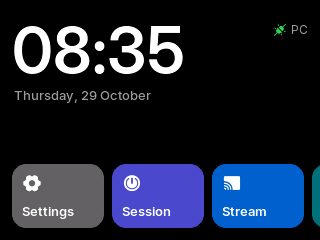
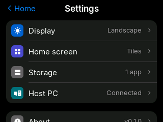
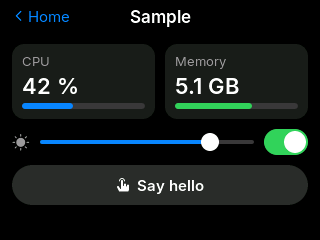

# fenixOS

A small operating system for the ESP32-2432S028R ("Cheap Yellow Display", 2.8" 320×240 touch screen), plus its companion app for Windows. Both share one version number.

- **Board:** C++17 on ESP-IDF v5.5.5, LVGL 9 + LovyanGFX. Boot screen, a home screen with time and date, three system apps (Settings, Session, Stream), apps installed from the PC, Wi-Fi (PC link, network time, weather, a status page at http://fenixos.local/) and burn-in protection for the LCD.
- **PC app:** Rust + Tauri 2 + Svelte 5. Lives in the tray, finds the board over USB (or Wi-Fi at fenixos.local), installs and switches apps, mirrors the board's screen, shows the board's load live (Task manager: CPU per core, memory, storage, the link, threads), keeps the board's firmware and time in step.
- **Design:** Apple-style dark theme (`DESIGN.md`), Inter and Phosphor icons.

Status: **v0.1.13.** Plan: `docs/PLAN.md`; progress: `tasks.md`.

  
  
  

## Install

1. Download `fenixOS_<version>_x64-setup.exe` from the [latest release](https://github.com/tariqaq/fenixOS/releases/latest) and run it. It installs for your user only, so Windows does not ask for admin rights.
2. The board's USB chip is a CH340. Windows usually installs its driver by itself; if the board does not show up as a COM port, install WCH's CH341SER driver. Use a current CH341SER. Both the 2011 driver and the current one (4.0.2026.2) can crash Windows when a program reads the port with a timeout. fenixOS reads without one since v0.1.1, and flashes the board without one since v0.1.4. Do not use fenixOS v0.1.0 on Windows, and avoid other serial tools (terminals, monitors, esptool) on this board.
3. Start fenixOS. On the first run a welcome window asks you to plug in the board. A board without fenixOS gets it installed after one confirm (this erases what was on it); a board on an older fenixOS is offered the update. Then the dashboard opens.

fenixOS lives in the tray and starts with Windows if you leave that on (Settings). It keeps the board's clock and firmware in step, and updates itself from the GitHub releases (Settings > Updates).

## What fenixOS does on your PC

Checked file by file in P42 (2026-11-01), with games that use kernel anti-cheat (Vanguard and similar) in mind:

- **Processes:** `fenixos.exe`, plus WebView2 only while its window is open, plus the PC half of each app you switch on (none by default). It caps its own CPU with a Windows job object; it never touches other processes.
- **Not used:** process or window lists, keyboard or mouse hooks, raw input, simulated input, screen capture, reading other programs' memory, DLL injection, drivers of its own, admin rights (only an app marked `elevated` asks, through UAC, each time it starts).
- **USB:** while no board is connected it lists USB serial ports once a second; a CH340 that does not answer as fenixOS is retried every 10 s. Connected, it reads the board's COM port every 2 to 10 ms and pings once a second. The only kernel driver involved is WCH's CH340 driver, which Windows installs for the board; no anti-cheat reports about it were found (searched 2026-11-01), but that is not a guarantee.
- **Network:** GitHub (update check at start, the app registry when Add app opens, downloads), Open-Meteo place search when you search, and the board itself on your LAN (TCP 7350, `fenixos.local` by mDNS every 5 s) only while no USB board is plugged in and the board was last seen with Wi-Fi on. `netsh wlan show networks` runs only when you scan for networks in Settings with the board's Wi-Fi off.
- To be sure during a match: Quit fenixOS from the tray. The board keeps running on its own (clock, apps without a PC half).

## How apps work

An app has two halves:

- **Board half:** a small package (`.fxp`, at most 64 KB) with a layout of labels, buttons, switches, sliders, bars, icons and images, and named bindings. The board draws it with the system theme. Spec: `docs/packages.md`.
- **PC half (optional):** a Windows program that fenixOS starts while the app is switched on. It sets binding values ("cpu = 42") and gets the board's taps and slider moves over named pipes. Rust apps use `crates/fenix-sdk`; the protocol is in `docs/sidecars.md`.

Apps come from the registry (`registry/`, rules in `docs/registry.md`). Switching an app on in the dashboard installs its package on the board and starts its PC half; switching it off removes both. `tools/sample-app` is a complete example.

**Make an app:** unzip `fenixos-app-template.zip` (source: `templates/app/`) into a new repo under `github.com/tariqaq/`, open Claude Code there and describe the app. The zip holds the agent rules, the format, design, PC-half and registry guides, a working starter app (board screen, Rust PC half, manifest) and the build, test and release tools.

## Build from source

Versions and every command are in `docs/toolchain.md`. In short:

- Clone with submodules: `git clone --recursive https://github.com/tariqaq/fenixOS`.
- Firmware (ESP-IDF v5.5.5): `pwsh -NoProfile -File board/idf.ps1 build`, `python tools/bundle_firmware.py`, then `cargo run -q -p fenix-cli --release -- flash` with the PC app closed (not `idf.ps1 flash`: see the CH340 note above).
- PC app (Rust, Node 24, pnpm): `python tools/bundle_firmware.py`, then `cd app; pnpm install; pnpm tauri dev`.
- Board simulator (no board needed, MSVC): `pwsh board/sim/build.ps1`, then `board/sim/build/fenix_sim.exe window`. `python tools/sim_shots.py` checks every board screen against `board/sim/golden/`.
- Tests: `cargo test --workspace`; CI runs these plus the firmware build, the simulator screens and the generator checks.

## Repo layout

| Path | What |
|---|---|
| `VERSION` | The only version source (lockstep SemVer) |
| `board/` | ESP-IDF firmware project |
| `app/` | Tauri + Svelte PC app |
| `crates/` | Shared Rust crates (protocol, link, packages, SDK, flasher, dev CLI) |
| `third_party/` | serialport, patched so reads never arm the CH340 driver's crashing timeout |
| `proto/` | Link protocol spec and test vectors |
| `registry/` | Manifests of installable apps (each app lives in its own repo) |
| `templates/app/` | App repo template; `fenixos-app-template.zip` is it zipped (`tools/app_template.py`) |
| `design/` | Design tokens and font sources |
| `tools/` | Generators and helper scripts |
| `docs/` | Plan, decisions, hardware facts, toolchain; `docs/legacy/` holds the FenixDeck PoC docs and the done-task history |
| `pics/` | Board photos and their analysis |

## Licence

MIT (`LICENSE`). Inter is under the SIL Open Font Licence; Phosphor icons are MIT.
